# SLAM for Micro-Robots using LiDAR and Wheel Encoders

**Bachelor's thesis project** · Transilvania University of Brașov · 2026
Author: **Eulalia-Andreea Jitaru** · Supervisor: Conf. dr. ing. Tiberiu Cociaș

A low-cost, fully self-built differential-drive mobile robot that **builds a map of an unknown indoor environment and localizes itself in it at the same time (SLAM)**, then moves autonomously while avoiding obstacles. The whole perception → processing → actuation chain runs on a Raspberry Pi 5 under **ROS 2 Jazzy**.

<p align="center">
  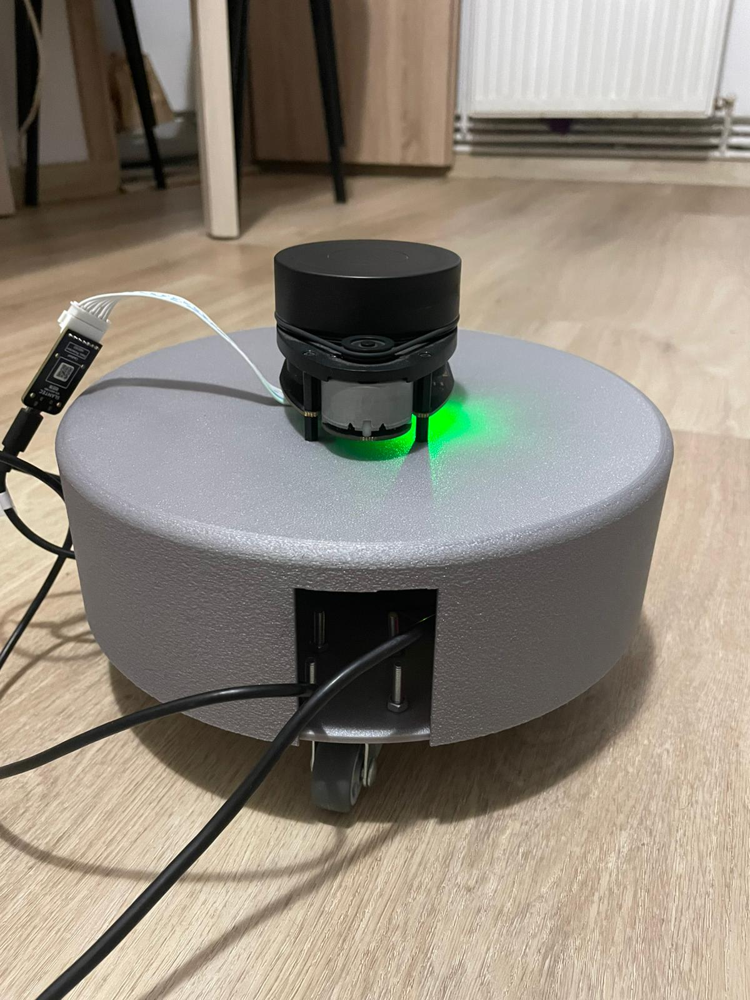
  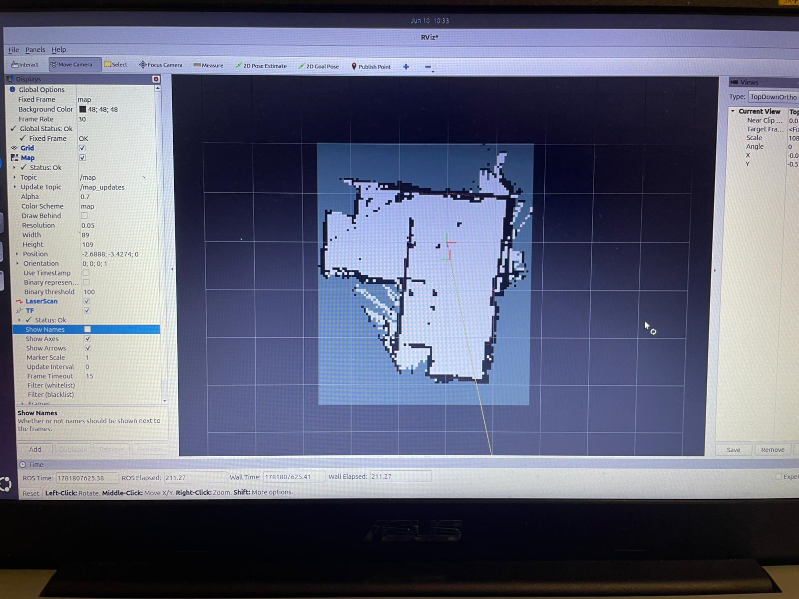
</p>

## Highlights

- **2D LiDAR SLAM** with SLAM Toolbox (scan matching, pose graph, loop closure), occupancy grid at **5 cm** resolution
- **Wheel-encoder odometry** (incremental optical encoders, 20-slot discs) with direct/inverse differential-drive kinematics and midpoint-Euler integration, fused with LiDAR through the **TF2** tree `map → odom → base_link → laser`
- **Autonomous navigation** on the saved map with Nav2 (AMCL localization + path planning)
- **Reactive obstacle avoidance** node based on LiDAR sectors (front / left / right)
- Full **Gazebo Harmonic simulation** of the robot and a test room, plus a launch for the **physical robot**
- **Closed-loop PID control** modelled, tuned and validated in MATLAB/Simulink (Kp = 3, Ki = 1, Kd = 0.5) against logged robot data
- **Distributed setup**: CycloneDDS for real-time telemetry and remote RViz2 monitoring over Wi-Fi
- Custom hardware: 2-tier cylindrical chassis designed in CATIA V5 and 3D-printed in PLA (Ø235 × 117 mm, 1.15 kg)

## Results

| Final SLAM map (real indoor space) | Simulation in Gazebo |
|---|---|
| 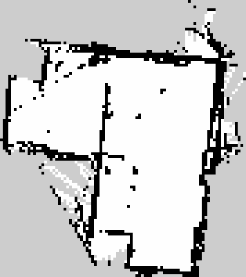 | 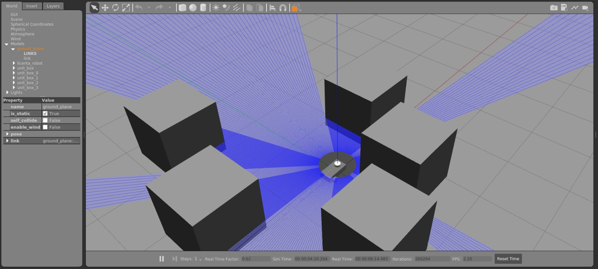 |

- An indoor space was mapped completely and the map was saved (`.pgm` + `.yaml`, see [`maps/`](maps/))
- The robot moved autonomously on the map, slowing down near obstacles and avoiding them, **without collisions**

## System architecture

<p align="center">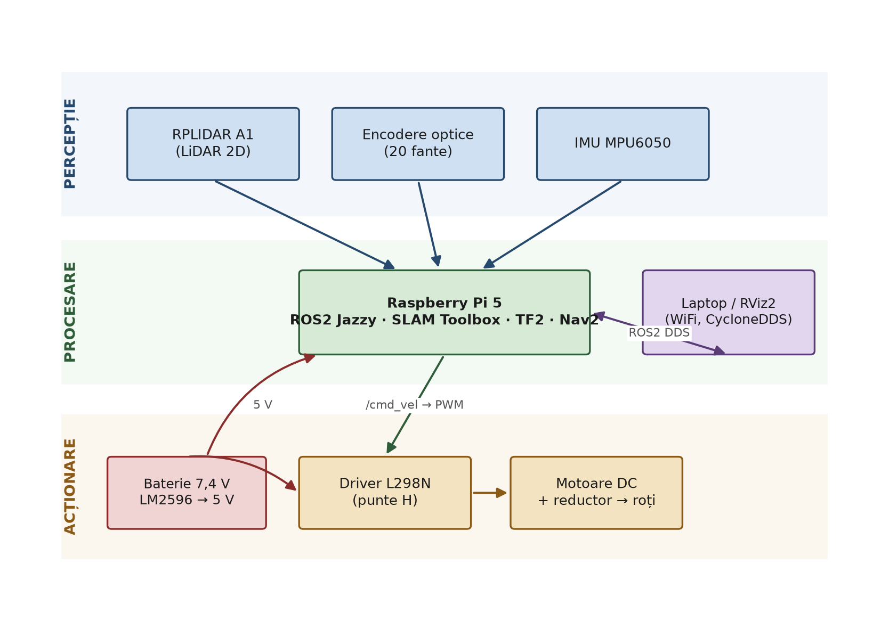</p>

| Layer | Components | ROS 2 topics |
|---|---|---|
| Perception | RPLIDAR A1 (360°), optical wheel encoders | `/scan`, `/odom` |
| Processing | Raspberry Pi 5 · ROS 2 Jazzy · SLAM Toolbox · TF2 · Nav2 | `/map`, `/tf` |
| Actuation | L298N dual H-bridge · 2 DC gear motors · caster wheel | `/cmd_vel` |

**Differential-drive kinematics** (wheel separation L = 0.18 m, wheel radius 0.033 m):

```
v = (v_R + v_L) / 2        ω = (v_R − v_L) / L
```

TF tree generated on the real robot (`ros2 run tf2_tools view_frames`):

<p align="center">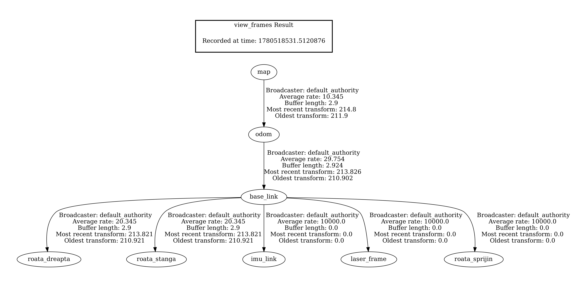</p>

## Hardware

| Component | Role |
|---|---|
| Raspberry Pi 5 | Main computer, runs ROS 2 |
| RPLIDAR A1 | 360° 2D laser scanner |
| DC gear motors + optical encoders | Drive and odometry |
| L298N | Motor driver (dual H-bridge) |
| LiPo 7.4 V + LM2596 | Power supply (5 V step-down) |
| 3D-printed PLA chassis | Ø235 mm × 117 mm, 1.15 kg |

<p align="center">
  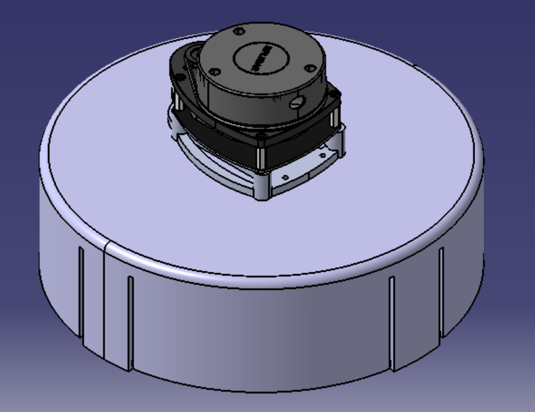
  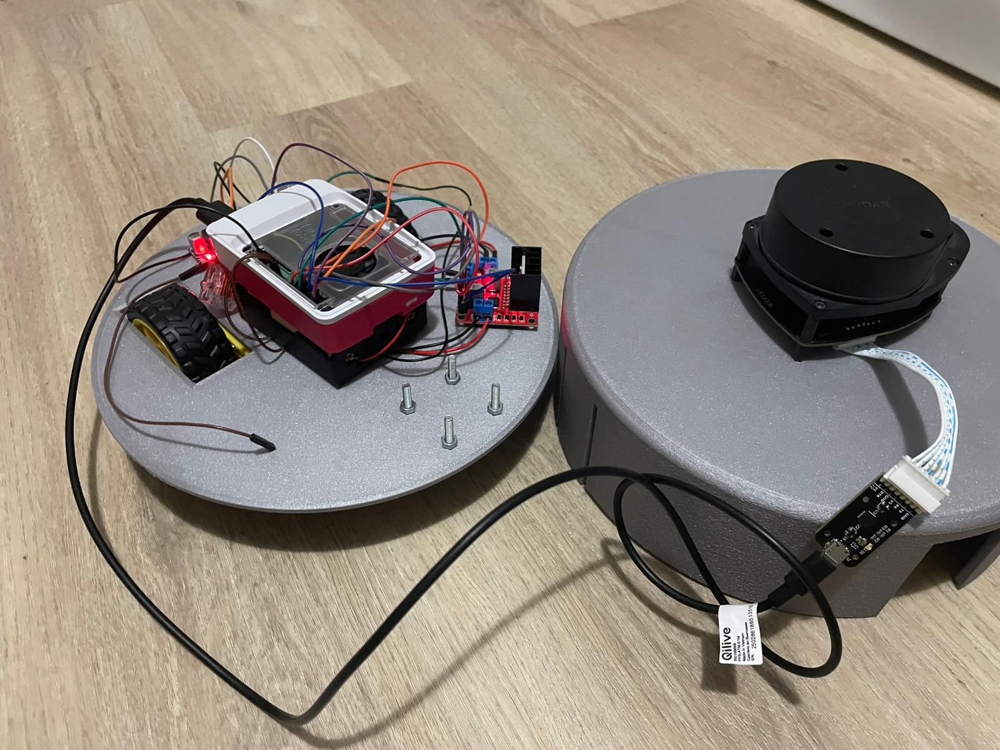
</p>

## Design figures

| Kinematics | Odometry pipeline | Electrical schematic |
|---|---|---|
| 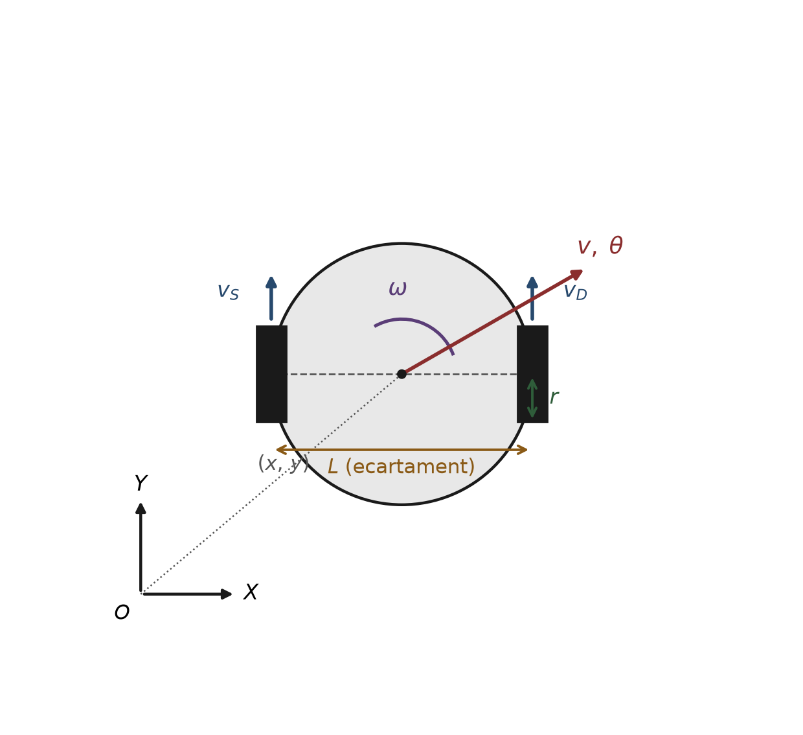 | 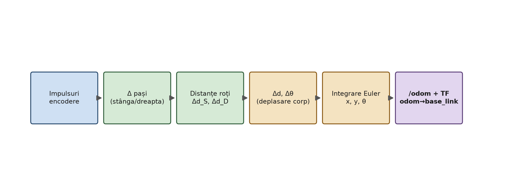 | 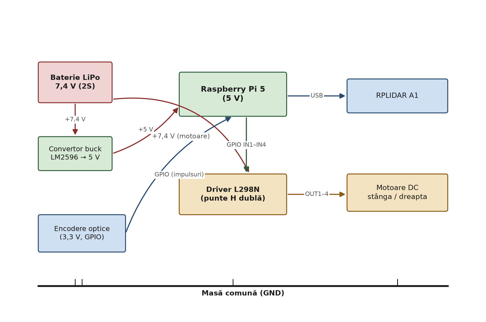 |
| **Optical encoder** | **SLAM Toolbox pipeline** | **Nav2 navigation** |
| 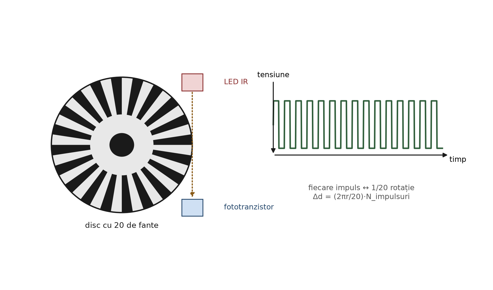 | 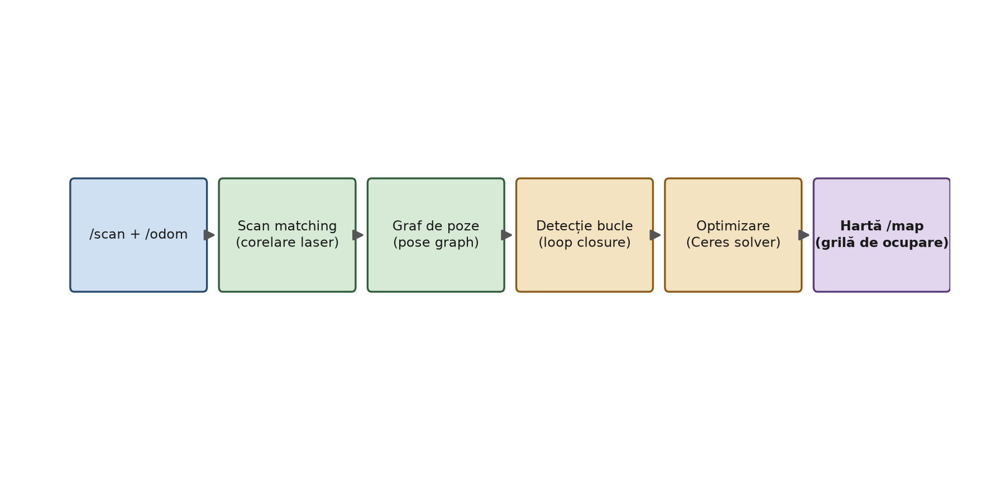 | 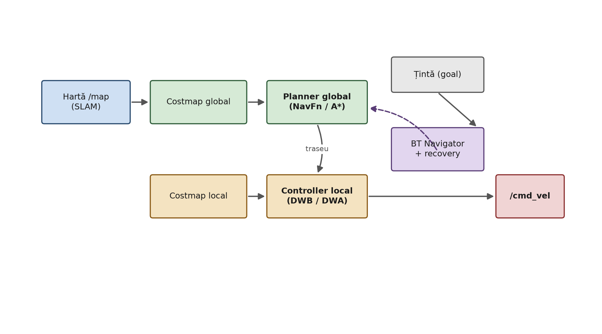 |
| **Mechanical sketch** | **Motor driver node flow** | **TF2 implementation** |
| 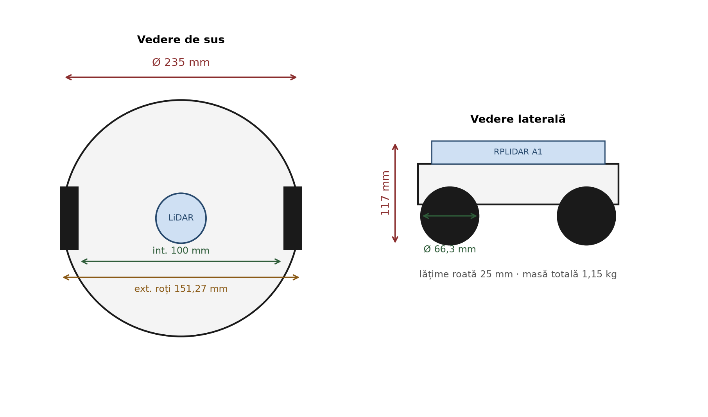 | 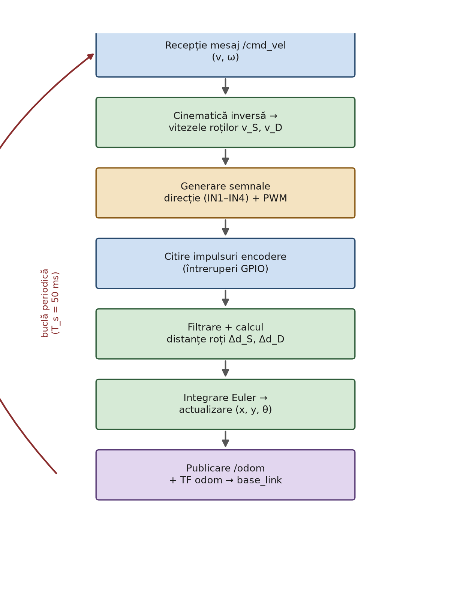 | 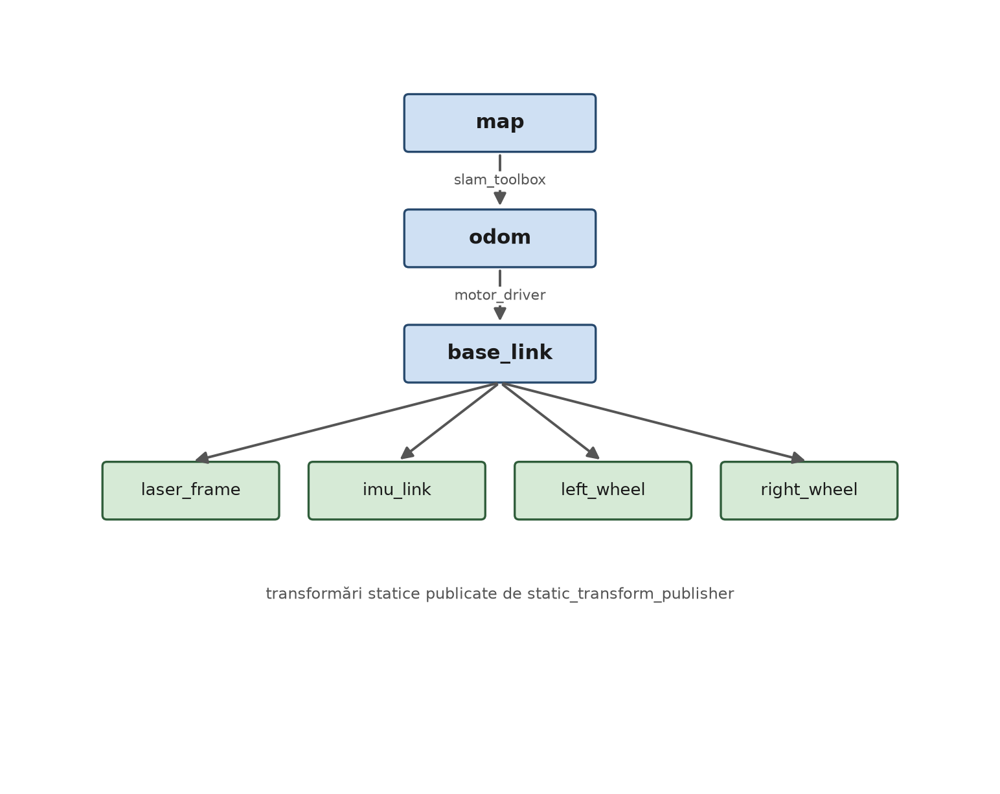 |

Full theoretical derivations, CAD models, electrical schematics and experimental results are in the thesis: [`docs/thesis_Jitaru_Eulalia_SLAM.pdf`](docs/thesis_Jitaru_Eulalia_SLAM.pdf) (Romanian).

## Repository structure

```
src/
├── robot_descriere/        # robot description package (ament_cmake)
│   ├── urdf/               # robot model
│   ├── worlds/             # Gazebo test room
│   ├── config/             # SLAM Toolbox, Cartographer, Nav2 parameters
│   ├── launch/             # simulation, SLAM, navigation, physical robot
│   ├── maps/               # map used for navigation
│   └── rviz/               # RViz2 configurations
└── robot_creier/           # robot nodes (ament_python)
    ├── evitare_obstacole.py    # LiDAR-based obstacle avoidance
    ├── hardware_interface.py   # /cmd_vel → motor PWM (gpiozero)
    ├── odom_to_tf.py           # /odom → TF odom→base_link
    └── scan_frame_fix.py       # LiDAR frame correction
matlab/                     # PID model (Simulink) and analysis of logged data
maps/                       # SLAM maps saved from the real robot
docs/                       # thesis PDF, design figures, photos
```

> Code comments and node names are in Romanian (the thesis language).

> **Note:** the `motor_driver` node (encoder odometry, `/odom` + `odom → base_link` TF, and PID wheel control), which ran on the Raspberry Pi, will be added in a follow-up commit.

## How to run

**Requirements:** Ubuntu 24.04, ROS 2 Jazzy, Gazebo Harmonic, `slam_toolbox`, `nav2_bringup`, `ros_gz`, `rplidar_ros`.

```bash
mkdir -p ~/ros2_ws && cd ~/ros2_ws
git clone https://github.com/eulaliajitaru/slam-micro-robot-ros2.git .
rosdep install --from-paths src --ignore-src -y
colcon build
source install/setup.bash
```

**Simulation – SLAM mapping**

```bash
ros2 launch robot_descriere slam_bringup.launch.py
# in another terminal, drive the robot:
ros2 run teleop_twist_keyboard teleop_twist_keyboard
# save the map:
ros2 run nav2_map_server map_saver_cli -f my_map
```

**Simulation – autonomous navigation on the saved map**

```bash
ros2 launch robot_descriere navigare.launch.py
```

**Physical robot**

```bash
# on the Raspberry Pi (starts the LiDAR and the motor driver)
./src/robot_descriere/launch/start_robot.sh
# on the laptop (SLAM + RViz2)
ros2 launch robot_descriere slam_physical.launch.py
```

## PID analysis (MATLAB / Simulink)

The distance-keeping controller was modelled in Simulink and compared with the error logged by the robot (`matlab/date_pid.csv`). The script `matlab/analiza_robot.m` computes the maximum error, mean error, RMSE and the step-response indicators.

<p align="center">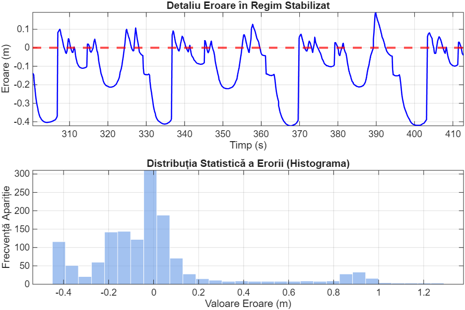</p>

## Tech stack

`ROS 2 Jazzy` · `Python` · `SLAM Toolbox` · `Nav2` · `TF2` · `Gazebo Harmonic` · `RViz2` · `URDF` · `Raspberry Pi 5` · `CycloneDDS` · `MATLAB / Simulink` · `CATIA V5`

## License

[MIT](LICENSE)
